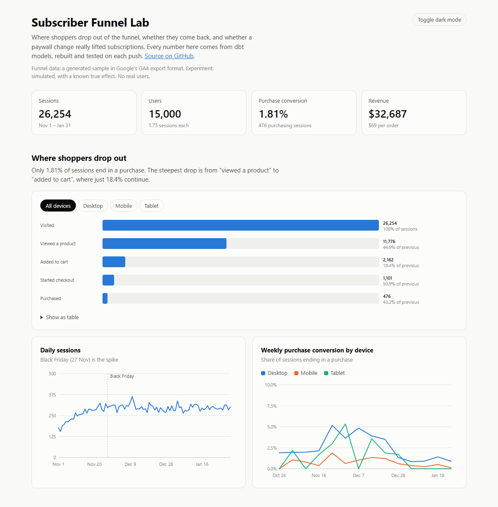
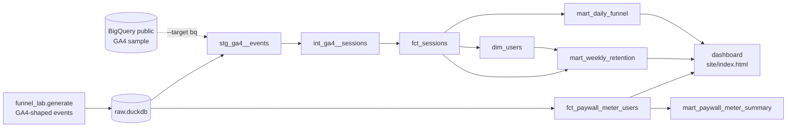
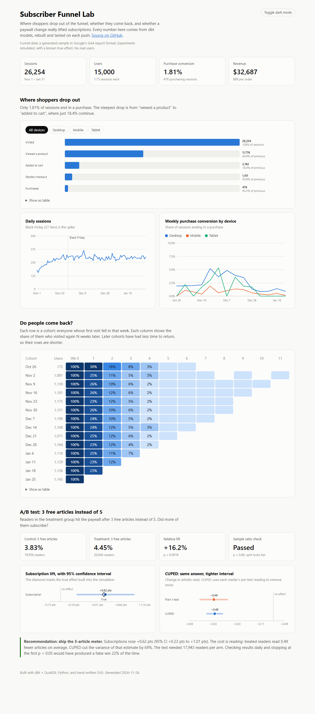

# Subscriber Funnel Lab

[](https://github.com/jkt6082/subscriber-funnel-lab/actions/workflows/ci.yml)

**Live dashboard: [jkt6082.github.io/subscriber-funnel-lab](https://jkt6082.github.io/subscriber-funnel-lab/)**
(rebuilt from raw data on every push to `main`)

SQL and dbt models that turn raw GA4 web events into a funnel, retention cohorts and a dashboard.
Also an A/B test analysis checked against a known ground truth.

- **dbt models:** raw events → sessions → users → daily funnel and weekly retention. There are
  35 models and data tests in all, run in CI on every push.
- **Runs in two places:** the same models run on **DuckDB** locally or on Google's **public GA4
  sample in BigQuery**. That sample is real, obfuscated Google Merchandise Store data. Locally
  they read a generated sample with the identical nested schema, so anyone can clone and run it
  in a minute.
- **Experiment analysis (Python):** a simulated paywall meter test (5 vs 3 free articles), with
  the true effect fixed in code. It covers:
  - a check that users were split as planned (sample ratio mismatch)
  - confidence intervals
  - CUPED variance reduction
  - a power calculation
  - a simulation of how peeking at results inflates false positives



## Findings

These come from the generated sample, so they show what the pipeline surfaces rather than facts
about a real store.

**1. Product page → cart is the leak.** 45% of sessions view a product, but only 18% of those add
it to the cart. Every later step keeps roughly half its sessions or more. That makes product pages
the first place to test changes.

**2. Mobile converts at a third of desktop's rate.** 2.54% of desktop sessions end in a purchase,
against 0.78% on mobile. Most of the gap opens at the same step: 22% of desktop product viewers
add to cart versus 13% on mobile. Mobile is 39% of traffic, so this is the biggest lever.

**3. Black Friday more than doubles conversion.** Conversion was 4.19% over the Black Friday
weekend, against 1.78% in the rest of November. December held at 2.87%, then fell to 0.80% after
Christmas.

**4. One in four new visitors comes back the next week.** Week-1 retention averages 25% across
cohorts, falls to about 11% by week 2 and to 2–3% by week 4. It is steady across cohorts, so
shoppers who arrived during the holiday rush were no more likely to return than anyone else.

**5. The paywall test: ship the 3-article meter.**

| | Control (5 free) | Treatment (3 free) |
|---|---|---|
| Readers | 19,956 | 20,044 |
| Subscription rate | 3.83% | 4.45% |

- **The result:** subscriptions rose by **+0.62 points (+16% relative)**, with a 95% CI of
  +0.23 to +1.01 points and p = 0.002. The interval contains the simulated true effect (+15%).
- **The cost:** treated readers read about 0.5 fewer articles over the test.
- **CUPED** used each reader's pre-test reading to cut the variance of that estimate by 69%.
  That's the same answer with an interval almost half as wide.
- **Trust checks:**
  - The split passed the sample ratio check (p = 0.66).
  - Checking results daily and stopping at the first p < 0.05 would have produced a false win
    22% of the time in A/A simulations. So this test ran to its planned size: 17,943 readers per
    arm for 80% power.

## Quick start (local, no cloud account)

```bash
python -m venv .venv && source .venv/bin/activate   # Windows: .venv\Scripts\activate
pip install -r requirements.txt
export DBT_PROFILES_DIR=.                          # Windows PowerShell: $env:DBT_PROFILES_DIR="."

python -m funnel_lab.generate     # writes data/raw.duckdb
dbt build                         # builds every model and runs every data test
python -m funnel_lab.experiments  # A/B test readout in the terminal
python -m funnel_lab.dashboard    # writes site/index.html
python -m funnel_lab.sql          # SQL prompt for exploring the tables
pytest
```

## Running on the real GA4 data in BigQuery

1. Create a Google Cloud project. The BigQuery sandbox is free and needs no card.
2. Install the BigQuery adapter and sign in:
   ```bash
   pip install dbt-bigquery
   gcloud auth application-default login
   export GCP_PROJECT=your-project-id
   ```
3. Build against the public dataset: `dbt build --target bq --exclude path:models/experiments`

The source switches to `bigquery-public-data.ga4_obfuscated_sample_ecommerce.events_*`
automatically. Adapter-specific SQL, such as unpacking GA4's nested `event_params`, lives in
[macros/ga4.sql](macros/ga4.sql) and dispatches per warehouse. The BigQuery target hasn't been
run in CI yet; see the roadmap.

## How it fits together



| Model | Grain | What it's for |
|---|---|---|
| `stg_ga4__events` | one row per event | Flattens GA4's nested export (params, device, geo) |
| `int_ga4__sessions` | one row per session | Funnel-step flags and revenue per session |
| `fct_sessions` | one row per session | Adds session number per user, duration, deepest funnel step |
| `dim_users` | one row per user | First-touch device, country and source, plus lifetime totals |
| `mart_daily_funnel` | day × device | Step counts and step-to-step conversion |
| `mart_weekly_retention` | cohort week × weeks since first visit | Share of each cohort active again |
| `fct_paywall_meter_users` | one row per test user | Experiment assignment and outcomes |

**Data tests** cover:
- uniqueness and not-null on every key
- the accepted values for categories
- that every session belongs to a known user
- a unique cohort-and-week pair in the retention table, using a custom generic test in
  [macros/](macros/test_unique_combination.sql)
- singular tests in [data_tests/](data_tests/): no funnel step exceeds its session count, week-0
  retention is always 100%, and rates stay between 0 and 1

Run `dbt docs generate && dbt docs serve` for the lineage graph and column docs.

## Project layout

```
models/          dbt models: staging → intermediate → marts, plus experiments
macros/          cross-warehouse SQL helpers and a custom generic test
data_tests/      singular dbt tests
funnel_lab/      Python: data generator, A/B stats, dashboard builder, SQL prompt
web/index.html   dashboard template (hand-written SVG charts, no chart library)
tests/           pytest unit tests for the stats and the generator
```

## Roadmap

- [ ] Run the BigQuery target against the real GA4 sample and record row counts and results here
- [ ] Sequential testing (e.g. mSPRT) as the fix for peeking
- [ ] Attribution: conversion by first-touch traffic source

## Data notes

The local GA4 sample is generated by [funnel_lab/generate.py](funnel_lab/generate.py) and is not
real traffic. The paywall experiment is simulated by
[funnel_lab/experiments/simulate.py](funnel_lab/experiments/simulate.py) and is not New York
Times data.


